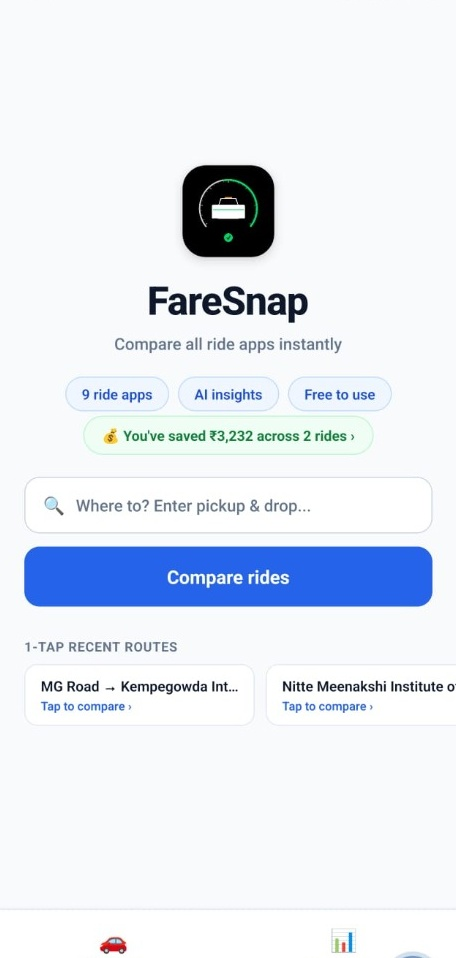
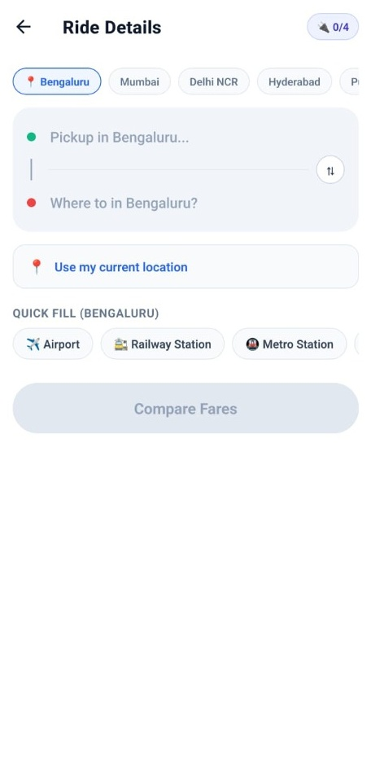
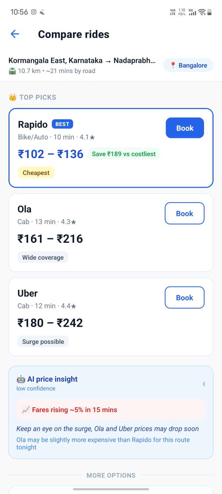

<div align="center">

# FareSnap

**Pan-India Multi-Modal Ride & Metro Aggregator with Live ONDC/Provider Bridges, Rain-Radar Surge Forecasting & Spend Lens**

[](https://expo.dev)
[](https://www.typescriptlang.org)
[](#system-architecture--core-engines)

</div>

---

## Overview

**FareSnap** is a Pan-India mobility comparison and booking engine built with **Expo SDK 58 & React Native** that compares real-time and calibrated fares across **8 ride-hailing providers** (**Uber, Ola, Rapido, Namma Yatri, InDrive, Bharat Cab, Meru, and Savaari**) and **20+ vehicle tiers** (`Bike`, `Auto`, `Cab`), alongside **Multi-Modal Metro + Auto/Bike split-route combinations**.

Unlike static fare calculators, FareSnap combines:
- **Live Provider & ONDC Bridges:** Direct **Namma Yatri (`api.moving.tech`)** OTP authentication, `/rideSearch` live quotes, and `/estimate/{id}/select2` in-app booking; **Rapido (`m.rapido.bike`)** `window.unupFe` PWA fare extraction; **ONDC Beckn (`ONDC:TRV10`)** BAP gateway (`ondc-test/server.js`); and hot-updatable **WebView `fetch`/`XHR`/DOM session scraping** for linked **Uber** and **Ola** accounts.
- **City-Locked & Pickup-Anchored Pan-India Autocomplete:** Parallel **Curated City Hub Index (<1ms)** + **Ola Maps** + **Bounded Nominatim (`viewbox` + `bounded=1`)** + **Photon (`bbox` + coordinate bias)** with a strict 90 km Haversine cutoff and dynamic Tier-2/Tier-3 GPS city detection across India.
- **Commuter Intelligence:** **OSRM step-junction Smart Pickup** (walk 100–250m past U-turns/signals to save ₹20–₹50 with an interactive Leaflet walking map), **Open-Meteo 15-minute rain-radar surge forecasting** with a 15m surge-drop countdown timer, **Waze-style crowdsourced surge pooling**, **Self-Learning EWMA Field Calibration**, **Commute Guard**, and **Spend Lens** analytics.

---

## App Preview

<p align="center">
  
  
  
  
  
</p>

---

## System Architecture & Core Engines

```text
  [Pickup & Drop / Google Maps Link] ──► City-Locked Autocomplete Engine (utils/placeAutocompleteEngine.ts)
                                         • Curated Metro Hubs + Parallel Ola Maps + Nominatim + Photon
                                         • 90km Haversine Cutoff & Dynamic Tier-2/Tier-3 GPS City Detection
                                                        │
                                                        ▼
                                  Parallel Ola Maps Traffic + OSRM (steps=true) Routing
                                  • Road Distance, Signal/Intersection Count & Turn Delays
                                                        │
         ┌──────────────────────────────────────────────┼──────────────────────────────────────────────┐
         ▼                                              ▼                                              ▼
  [Live Provider & ONDC Bridges]             [Commuter Savings Engines]                     [Surge & Spend Intelligence]
  • Namma Yatri Direct API (OTP + select2)   • Smart Pickup Junction Probe + Walking Map    • Open-Meteo 15m Rain Radar
  • Rapido PWA (window.unupFe) Bridge        • Metro + First/Last-Mile Auto Split Engine    • Cloud Surge Pool + EWMA Calibration
  • ONDC:TRV10 BAP Server + WebView Pool     • Commute Guard & 15m Surge Drop Timer         • Groq + Gemini Dual-LLM Proxy & Spend Lens
```

### Key Engineering Modules

1. **Direct Namma Yatri API & Live Session Bridges (`utils/nammaYatriDirectApi.ts`, `utils/liveSessionBridge.ts`, `components/LiveFareScraperPool.tsx`)**:
   - Connects directly to Namma Yatri's production backend (`https://api.moving.tech/pilot/app/v2`) for OTP login, `/rideSearch` live quotes, automatic `401` token expiry detection, and `/estimate/{id}/select2` in-app ride dispatch.
   - Extracts live estimates from Rapido's `m.rapido.bike` Angular `window.unupFe.component` and intercepts `Response.prototype.json`, `XMLHttpRequest`, and DOM product rows for linked Uber and Ola sessions using hot-updatable selector rules (`/scraper-config`).
2. **City-Locked & Pickup-Anchored Place Autocomplete (`utils/placeAutocompleteEngine.ts` & `utils/mapsLinkParser.ts`)**:
   - Anchors destination searches strictly to the user's selected Pickup coordinates and active city (`viewbox` + `bounded=1` + 90 km Haversine filter), eliminating cross-state noise while supporting Google Maps URLs (`maps.app.goo.gl`, `@lat,lng`, `!3d!4d`) and dynamic Tier-2/Tier-3 Indian cities.
3. **OSRM Step-Junction Smart Pickup & Interactive Walking Map (`utils/smartPickupEngine.ts`, `components/RoutePreviewMapModal.tsx`)**:
   - Inspects actual OSRM `steps=true` road maneuvers to test whether walking 100–250m to the primary road junction avoids U-turn loops and geofence surcharges, rendering the green-to-blue dashed walking path on an interactive Leaflet + OpenStreetMap modal with 1-tap Google Maps walking navigation.
4. **60-Minute Rain-Radar Surge Forecaster & Self-Learning Calibration (`utils/weatherSurgeEngine.ts`, `utils/fareCalibration.ts`, `utils/fareReporter.ts`)**:
   - Queries Open-Meteo's `minutely_15` precipitation radar at the pickup coordinates, pools live and user-reported fares into the cloud surge pool (`/fare-reports` + Supabase RLS), and updates an exponentially weighted moving average (EWMA) calibration multiplier per city and provider.
5. **ONDC `ONDC:TRV10` BAP Gateway & Dual-LLM Proxy (`ondc-test/server.js`, `ondc-test/generate-keys.js`)**:
   - Zero-dependency Node.js server implementing Beckn `ONDC:TRV10` `/search` & `/on_search` with `BLAKE-512` + `Ed25519` signing, `/fare-reports` persistence, `/scraper-config` hot updates, and a server-side Groq + Google Gemini fallback proxy.

---

## Tech Stack

| Layer | Technology |
| :--- | :--- |
| **Mobile & Web Framework** | React Native `0.88`, Expo SDK `58`, Expo Router, TypeScript `5.9` |
| **Autocomplete & Routing** | OSRM (`steps=true`), Ola Maps API, Bounded Nominatim, Komoot Photon, Leaflet + OpenStreetMap |
| **Live Ride Bridges** | Namma Yatri REST API (`api.moving.tech`), Rapido PWA `unupFe` Bridge, `react-native-webview` Hook Pool |
| **Cloud Backend & Protocol** | Node.js ONDC `ONDC:TRV10` BAP Gateway, Supabase PostgreSQL + RLS (`supabase/schema.sql`) |
| **Weather & AI Insights** | Open-Meteo 15-Minute Radar API, Groq + Gemini Dual-LLM Proxy |

---

## Quick Start

> **For detailed setup instructions, see [SETUP.md](./SETUP.md).**

```bash
git clone https://github.com/YOUR_GITHUB_USERNAME/FareSnap.git
cd FareSnap
npm install

# Configure your environment
cp .env.example .env
# Edit .env and fill in your API keys (see SETUP.md for details)

# Start the backend (AI proxy + ONDC gateway + surge pool)
npm run backend

# Start the Expo app
npx expo start
```

---

## Repository Structure

```text
FareSnap/
├── app/
│   ├── _layout.tsx                    # Root stack & Render cloud pre-warm heartbeat
│   ├── (tabs)/
│   │   ├── _layout.tsx                # Compare + Spend Lens bottom tab navigator
│   │   ├── index.tsx                  # Home Command Center, Commute Guard & 1-tap recent routes
│   │   └── spend.tsx                  # Spend Lens analytics, provider split & trip ledger
│   ├── location.tsx                   # City-locked autocomplete, Quick Hubs & Maps link input
│   └── results.tsx                    # Live 20+ product comparison, Smart Pickup, Metro combo & AI forecast
├── components/
│   ├── ConfirmPickupMapModal.tsx      # Draggable Leaflet + OpenStreetMap pickup pin modal
│   ├── RoutePreviewMapModal.tsx       # Smart Pickup walking path & route preview map modal
│   ├── LinkAppsModal.tsx              # Namma Yatri OTP login, WebView session linker & bridge diagnostics
│   └── LiveFareScraperPool.tsx        # Offscreen WebView pool for Rapido, Uber & Ola live scraping
├── ondc-test/
│   ├── server.js                      # ONDC:TRV10 BAP gateway, surge pool, scraper config & AI proxy
│   └── generate-keys.js               # Ed25519 + X25519 keypair generator for ONDC registration
├── supabase/
│   └── schema.sql                     # Production PostgreSQL table, indexes & RLS policies
├── .env.example                       # Environment variable template (copy to .env)
├── SETUP.md                           # Developer handover & quick-start guide
└── utils/
    ├── placeAutocompleteEngine.ts     # City-locked & pickup-anchored Pan-India autocomplete engine
    ├── nammaYatriDirectApi.ts         # Production Namma Yatri OTP auth, rideSearch & select2 booking client
    ├── liveSessionBridge.ts           # WebView fetch/XHR/DOM hook generator, Rapido bridge & trip storage
    ├── distanceEngine.ts              # Parallel Ola Maps + OSRM step-intersection road routing
    ├── smartPickupEngine.ts           # OSRM step-junction & multi-bearing Smart Pickup probe
    ├── weatherSurgeEngine.ts          # Open-Meteo 15-minute rain radar surge forecaster
    ├── metroComboEngine.ts            # First-Mile Auto + Metro + Last-Mile Auto split-route engine
    ├── fareCalibration.ts             # Self-learning EWMA field calibration engine
    ├── fareReporter.ts                # Cloud & Supabase crowdsourced surge pooling client
    ├── commuteGuard.ts                # Proactive daily commute rain & surge alert evaluator
    ├── mapsLinkParser.ts              # Google Maps URL, geo URI & coordinate resolver
    ├── fareEngine.ts                  # 2026 calibrated city tariffs & airport/mall geofence fees
    └── appUrls.ts                     # Native deep links, walking directions & clipboard handoff
```

---

## License

MIT License
