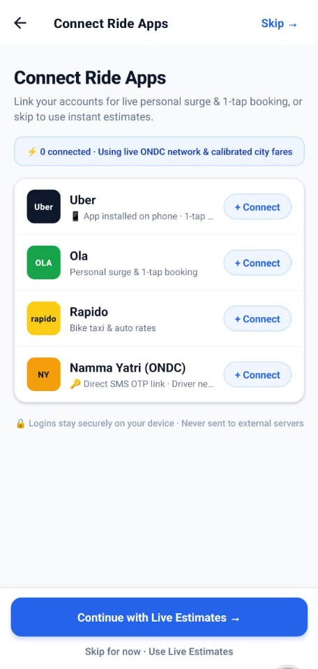
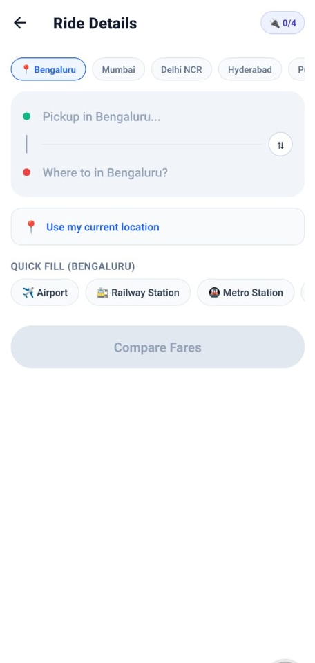
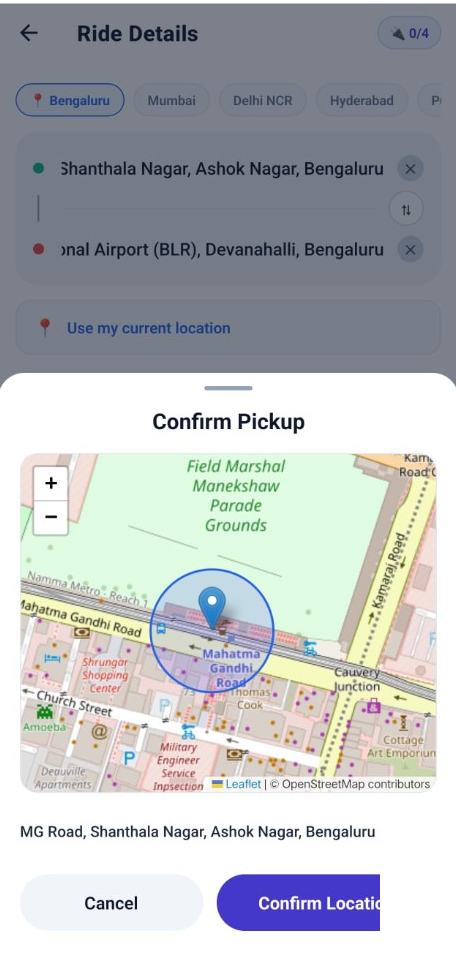
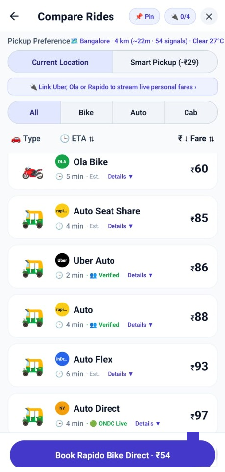

# FareSnap (RideCompare) — Multi-Modal Urban Mobility Reference Archive

> **Status: Archived Prototype** — Consumer multi-app aggregation was sunset due to walled-garden anti-bot constraints. The core ONDC Beckn TRV10 BAP gateway and Indian geo-intelligence engines are being extracted into a standalone open-source protocol kit.

---

## App Preview

<p align="center">
  
  
  
  
  
</p>
<p align="center">
  <em>Pan-India Urban Mobility UI Flow: 1. Home Command Center & Commute Guard · 2. Hybrid Provider Connection Hub (Workflow C) · 3. 4-Tier Bounded Autocomplete · 4. Interactive Pickup Pin Snapper · 5. Multi-Tier Compare with Smart Pickup (-₹29) & ONDC Live Estimates</em>
</p>

---

## 1. System Architecture

FareSnap is a full-stack mobility aggregator designed for Indian metropolitan transit networks. It pairs an **Expo SDK 58 / React Native** mobile client with an **ONDC Beckn TRV10 BAP Gateway** and India-specific geo-intelligence engines.

```text
  [Pickup & Drop Coordinates / Google Maps Short Link]
                           │
                           ▼
  [4-Tier India-Bounded Geocoder & Autocomplete Engine]
  • Layer 1: In-Memory Curated Metro Hub Trie (<1ms)
  • Layer 2: Ola Maps India POI Index with GPS Biasing
  • Layer 3: Bounded Nominatim (viewbox + bounded=1)
  • Layer 4: Komoot Photon (bbox + coordinate bias)
  • Filter:  Strict 90 km Haversine cutoff & GPS city detection
                           │
                           ▼
  [Routing & Commuter Savings Intelligence]
  • OSRM step-junction Smart Pickup (snaps to main road nodes past U-turns)
  • Multimodal Metro Rail + First/Last-Mile Auto Split Engine
  • Open-Meteo 15-Minute Rain-Radar Surge Forecaster (1.25x–1.65x multiplier)
  • EWMA Self-Learning Field Calibration
                           │
         ┌─────────────────┴─────────────────┐
         ▼                                   ▼
  [ONDC Beckn TRV10 BAP Gateway]      [Native App Integration Bridge]
  • Ed25519 signing (Blake2b)        • Scheme queries (uber://, olacabs://)
  • Catalog parser (TRV10 schema)     • Pre-filled coordinate handoff
  • Staging registry integration      • Namma Yatri SMS OTP (api.moving.tech)
```

---

## 2. Core Engineering Modules

### 2.1 4-Tier India-Bounded Geocoder (`utils/placeAutocompleteEngine.ts`)
Standard geocoders suffer from cross-state ambiguity in India (e.g., searching for "Koramangala" while in Mumbai returns Bengaluru results). FareSnap enforces a 4-tier parallel pipeline:
1. **Curated Hub Index (<1ms):** In-memory trie containing top 100+ airports, railway stations, metro interchanges, and IT hubs per city.
2. **Ola Maps Autocomplete:** India-specialized POI database anchored to the user's current city center.
3. **Bounded Nominatim (OpenStreetMap):** Constrained using `viewbox` coordinates with `bounded=1` and `countrycodes=in`.
4. **Photon Geocoder:** Coordinate-biased secondary fallback.
5. **Spatial Boundary Filter:** Rejects any result exceeding a **90 km** Haversine radius from the city centroid.

### 2.2 OSRM Smart Pickup U-Turn Node Snapper (`utils/smartPickupEngine.ts`)
In Indian cities, divided arterial roads frequently trap drivers into 2 km U-turn detours. 
- The engine reverse-geocodes the exact pickup coordinates and inspects OSRM `steps=true` turn maneuvers.
- If a main road junction or arterial node exists within a 50m – 200m walking distance (<3 minutes), it surfaces a **Smart Pickup Point**.
- Renders an interactive Leaflet + OpenStreetMap walking path and calculates the ₹20 – ₹50 deadhead fare savings.

### 2.3 ONDC Beckn TRV10 BAP Gateway (`ondc-test/server.js`)
A Node.js implementation of an Open Network for Digital Commerce (ONDC) Buyer App Participant (BAP) under the `ONDC:TRV10` mobility specification:
- **Cryptographic Authorization:** Signs outbound Beckn broadcast requests (`/search`) using **Ed25519** keypairs with **Blake2b** digest hashing:
  ```text
  Signature keyId="bap.faresnap.com|key1|ed25519",algorithm="ed25519",created="...",expires="...",headers="(created) (expires) digest",signature="..."
  ```
- **Catalog Normalization:** Parses BPP (Beckn Provider Platform) `/on_search` payloads into uniform vehicle tiers (`Bike`, `Auto`, `Cab Economy`, `Cab Premium`).
- **Direct Moving Tech Driver Link:** Integrates with `api.moving.tech` for Namma Yatri SMS OTP verification and live driver quote streaming.

### 2.4 Rain-Radar Surge Forecasting (`utils/fareEngine.ts`)
- Queries Open-Meteo's `minutely_15` precipitation radar at pickup coordinates.
- Rain rates $\ge 2.5\text{ mm/hr}$ dynamically calculate surge inflation (1.25x to 1.65x).
- Surfaces a countdown timer indicating when precipitation is forecasted to clear so users can delay booking to avoid surge.

### 2.5 Hybrid Provider Connection Hub (`app/plugins.tsx`, `components/LinkAppsModal.tsx`)
Rather than forcing login walls or relying exclusively on brittle web scrapers, FareSnap implements **Workflow C (Hybrid Provider Gateway)**:
- **Verified ONDC / Open Protocol Flow:** Direct Namma Yatri driver quotes and SMS OTP verification via `api.moving.tech`.
- **Native App Bridge:** Deep-links directly to installed ride-hailing apps (`uber://`, `olacabs://`, `rapido://`) with pre-filled pickup/dropoff coordinates.
- **Calibrated Instant Estimates Fallback:** If accounts are unlinked or skipped, FareSnap displays real-time calibrated city fares and ONDC network estimates immediately without blocking the commuter.
- **Client-Side Security:** Login tokens and phone numbers remain strictly in secure local storage and are never transmitted to external cloud servers.

---

## 3. Key Technical Lessons Learned

1. **The Fragility of Client-Side Consumer Scraping:**
   Private ride-hailing networks (Uber, Ola, Rapido) deploy aggressive anti-bot defenses (Akamai Bot Manager, Cloudflare Turnstile, TLS fingerprinting, and dynamic DOM obfuscation). Attempting to scrape live consumer pricing via in-app WebViews or reverse-engineered endpoints is inherently unstable for production B2C applications and creates a continuous maintenance loop.
2. **The Inevitability of Open Protocols (ONDC):**
   Sustainable multi-provider aggregation requires protocol-level cooperation rather than client-side scraping. The ONDC Beckn TRV10 specification demonstrates how open schemas allow independent buyer applications to query distributed provider networks cleanly via standardized cryptographic contracts.
3. **Spatial Realities of Indian Urban Transit:**
   Naive Euclidean distance metrics fail in Indian cities. Divided road medians, gated tech park security barriers, and high-density urban canyons make routing engine junction inspection and smart road-node snapping essential for realistic fare calculation and driver pickup success.

---

## 4. Setup & Local Development

### Prerequisites
- Node.js `20.x` LTS or `bun`
- Expo CLI (`npm install -g expo-cli`)
- Expo Go on Android / iOS (SDK 58)

### Installation

```bash
# Clone the repository
git clone https://github.com/deveshkolte/FareSnap.git
cd FareSnap

# Install dependencies (bun or npm)
bun install
# or: npm install

# Configure environment variables
cp .env.example .env
```

### Environment Configuration (`.env`)

Fill in the required keys in `.env` (refer to `.env.example`):
```ini
# Cloud Backend / BAP Gateway (local or deployed)
EXPO_PUBLIC_ONDC_BAP_URL=http://localhost:4040
EXPO_PUBLIC_AI_PROXY_URL=http://localhost:4040/proxy/ai-insight

# Ola Maps API Key (India geocoding & routing)
EXPO_PUBLIC_OLA_MAPS_API_KEY=your_ola_maps_key_here
```

### Running the Project

```bash
# 1. Start the ONDC BAP Gateway Server
npm run backend

# 2. Start the Expo Development Server
npx expo start

# 3. Run Engine Unit Tests
npm test
```

---

## 5. Repository Structure

```text
FareSnap/
├── app/
│   ├── (tabs)/
│   │   ├── index.tsx          # Home dashboard, Commute Guard & recent routes
│   │   └── spend.tsx          # Spend Lens commute analytics & trip history
│   ├── _layout.tsx            # Root navigation stack & BAP pre-warm ping
│   ├── plugins.tsx            # Hybrid provider connection hub (Workflow C)
│   ├── location.tsx           # City-locked 4-tier autocomplete & hub selector
│   └── results.tsx            # Quote aggregation, metro split & booking handoff
├── components/
│   ├── LinkAppsModal.tsx      # Hybrid connection sheet (OTP + Native App Bridge)
│   ├── ConfirmPickupMapModal.tsx # Interactive Leaflet pickup pin adjuster
│   └── RoutePreviewMapModal.tsx  # Leaflet route polyline & junction visualizer
├── utils/
│   ├── placeAutocompleteEngine.ts # 4-tier parallel city-locked geocoder
│   ├── smartPickupEngine.ts   # OSRM step-junction walking node snapper
│   ├── ondcLiveEngine.ts      # ONDC Beckn TRV10 search & catalog parser
│   ├── nammaYatriDirectApi.ts # Moving Tech SMS OTP auth & direct booking client
│   ├── fareEngine.ts          # Baseline tariffs & Open-Meteo rain surge engine
│   ├── metroComboEngine.ts    # Multimodal transit split-route calculator
│   ├── distanceEngine.ts      # Ola Maps & OSRM road distance routing
│   └── appUrls.ts             # Native deep-link schemes & store fallbacks
├── ondc-test/
│   ├── server.js              # Express ONDC Beckn BAP gateway with Ed25519 signing
│   └── generate-keys.js       # Ed25519 keypair generator for ONDC registration
└── tests/
    └── engines.test.js        # Unit test suite for Beckn payloads & quote engines
```

---

## 6. License

This repository is archived and published as a reference implementation under the [MIT License](LICENSE).
