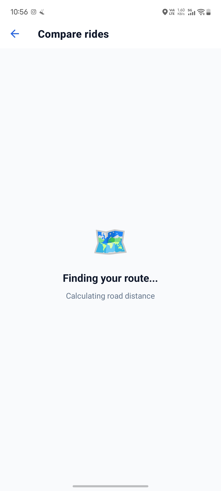
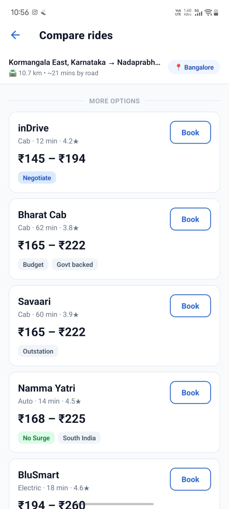

<div align="center">

# FareSnap

**Multi-Modal Ride & Metro Aggregator with Crowdsourced Surge Pooling and Rain-Radar Forecasting**

[](https://expo.dev)
[](https://www.typescriptlang.org)
[](https://supabase.com)
[](#system-architecture)
[](https://github.com/deveshkolte/FareSnap/releases/latest)

</div>

---

## Overview

**FareSnap** is a cross-city mobile mobility aggregator built for **9 Indian cities** that compares real-time fares across **9 ride-hailing providers** (**Uber, Ola, Rapido, Namma Yatri, BluSmart, Meru, inDrive, Bharat Cab, and Savaari**) alongside **Multi-Modal Metro + Auto/Bike split-route combinations**.

Beyond fare comparison, FareSnap integrates **Waze-style crowdsourced neighborhood surge pooling** backed by Supabase, **60-minute rain-radar surge forecasting** via Open-Meteo, **ONDC Beckn protocol** quote adapters, and **Groq (`Llama-3.1-8B`)** fare decision insights with one-tap deep-link booking.

---

## App Preview

<p align="center">
  
  
  
  
  
</p>

---

## System Architecture & Core Engines

```text
  [Pickup & Drop Input] ──► Multi-Engine Geocoder (Ola Maps + Nominatim India + Photon)
                                       │
                                       ▼
                        OSRM Road Geometry & Live Traffic ETA
                                       │
         ┌─────────────────────────────┼─────────────────────────────┐
         ▼                             ▼                             ▼
  [Async QuoteEngine]       [Metro + Auto Split Engine]   [Live Surge Intelligence]
  • ONDC Beckn Provider     • Haversine Station Search    • Supabase Fare Reporter
  • Live Session Bridge     • First/Last-Mile Auto/Bike   • 15-Min Open-Meteo Radar
  • 9-App City Tariffs      • Total Time & Cost Delta     • Groq Llama-3.1-8B Advice
```

### Key Engineering Modules

1. **Asynchronous Multi-Provider `QuoteEngine` (`utils/quoteEngine/QuoteEngine.ts`)**:
   - Coordinates synchronous tariff estimators and asynchronous live providers (**ONDC Beckn protocol adapter** `OndcBecknProvider.ts` and `liveSessionBridge.ts`), deduplicating quotes and streaming updates to the UI as providers resolve.
2. **Multi-Modal Metro + Auto/Bike Split-Route Engine (`utils/metroComboEngine.ts`)**:
   - Discovers the nearest origin and destination metro stations within a `3.5 km` Haversine radius across 9 city metro networks (Namma Metro, DMRC, Mumbai Metro, etc.) and calculates combined `First-Mile Auto/Bike + Metro + Last-Mile Auto/Bike` cost and travel time savings against direct cab rides.
3. **Waze-Style Crowdsourced Neighborhood Surge Pooling (`utils/fareReporter.ts`)**:
   - Pools user-reported fare quotes into **Supabase** (`fare_reports`) with per-km sanity bounds (`₹3–₹350/km`) and 60-second deduplication cooldowns, computing real-time neighborhood surge multipliers for nearby commuters.
4. **60-Minute Rain-Radar Surge Forecaster (`utils/weatherSurgeEngine.ts`)**:
   - Queries Open-Meteo's `minutely_15` precipitation radar at the exact pickup GPS coordinates to model weather-induced cab/auto/bike surge multipliers (`1.16x` to `1.52x`) and advise whether waiting 15–30 minutes avoids rain surge.
5. **Multi-Engine India Geocoding (`utils/distanceEngine.ts`)**:
   - Combines **Ola Maps**, **Nominatim India**, and **Komoot Photon** with **OSRM** road routing and `expo-location` reverse geocoding across **Bengaluru, Mumbai, Delhi NCR, Hyderabad, Chennai, Pune, Kolkata, Ahmedabad, and Jaipur**.

---

## Tech Stack

| Layer | Technology |
| :--- | :--- |
| **Mobile Framework** | React Native, Expo, Expo Router, TypeScript |
| **Routing & Geocoding** | OSRM, Ola Maps, Nominatim, Komoot Photon, `expo-location` |
| **Backend & Surge Pool** | Supabase (PostgreSQL REST API), ONDC Beckn Protocol |
| **Weather & AI Insights** | Open-Meteo 15-Minute Radar API, Groq API (`llama-3.1-8b-instant`) |
| **Build & Distribution** | EAS Build (Android APK / AAB), `AsyncStorage` |

---

## Quick Start

```bash
git clone https://github.com/deveshkolte/FareSnap.git
cd FareSnap
npm install

# Configure environment variables
echo "EXPO_PUBLIC_GROQ_API_KEY=your_groq_key" > .env

# Launch Expo development server
npx expo start
```

---

## Repository Structure

```text
FareSnap/
├── app/
│   ├── (tabs)/index.tsx           # Home screen, city detection & recent routes
│   ├── location.tsx               # Multi-engine address autocomplete screen
│   └── results.tsx                # Live quote stream, Metro split card & rain radar UI
├── components/
│   ├── ConfirmPickupMapModal.tsx  # Interactive pin confirmation modal
│   └── LiveFareScraperPool.tsx    # Live session quote bridge component
└── utils/
    ├── quoteEngine/               # Async QuoteEngine + ONDC Beckn & Estimate providers
    ├── metroComboEngine.ts        # Haversine Metro + Auto/Bike split-route calculator
    ├── fareReporter.ts            # Supabase crowdsourced surge pooling client
    ├── weatherSurgeEngine.ts      # Open-Meteo 60-min rain radar surge engine
    ├── smartPickupEngine.ts       # Walk-to-save pickup optimization
    ├── distanceEngine.ts          # Multi-engine geocoding & OSRM road distance
    ├── fareEngine.ts              # City-calibrated tariff & surge models
    └── appUrls.ts                 # Deep links to Uber, Ola, Rapido, Namma Yatri, etc.
```

---

## License

MIT License — Created by **[Devesh Kolte](https://github.com/deveshkolte)**.
